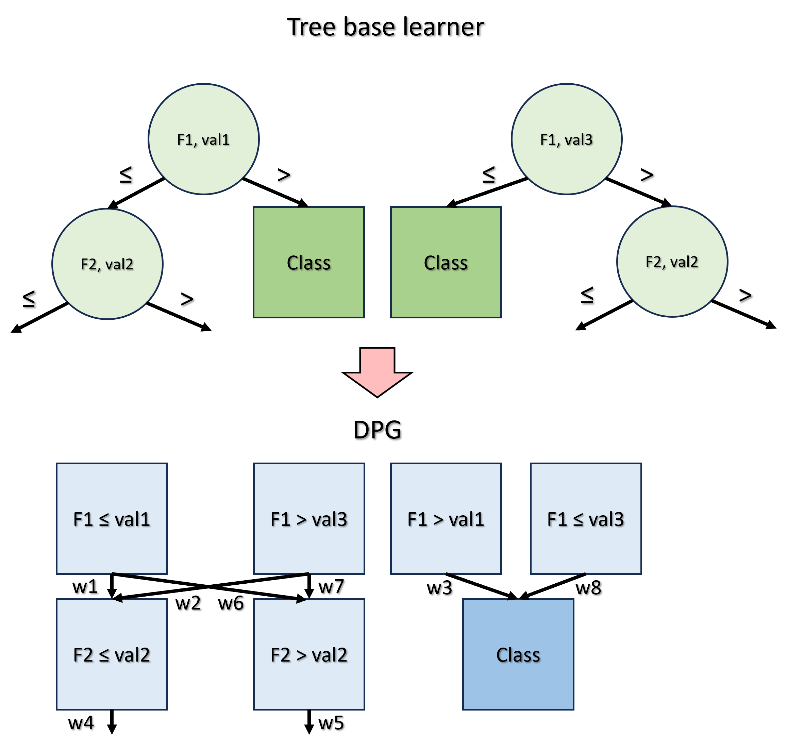
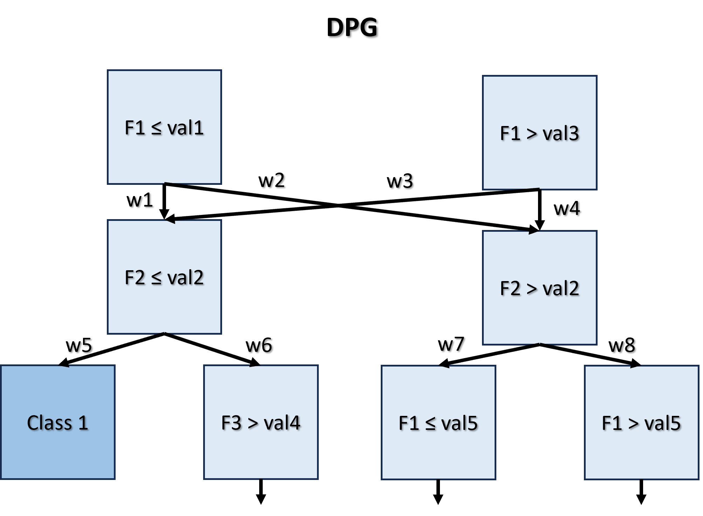
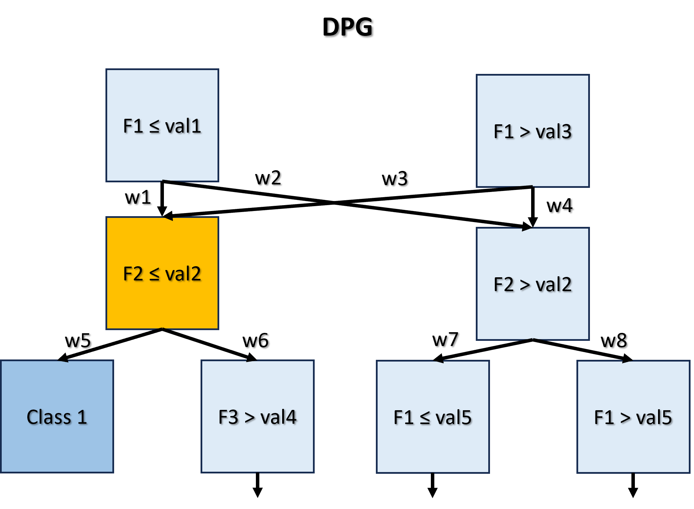
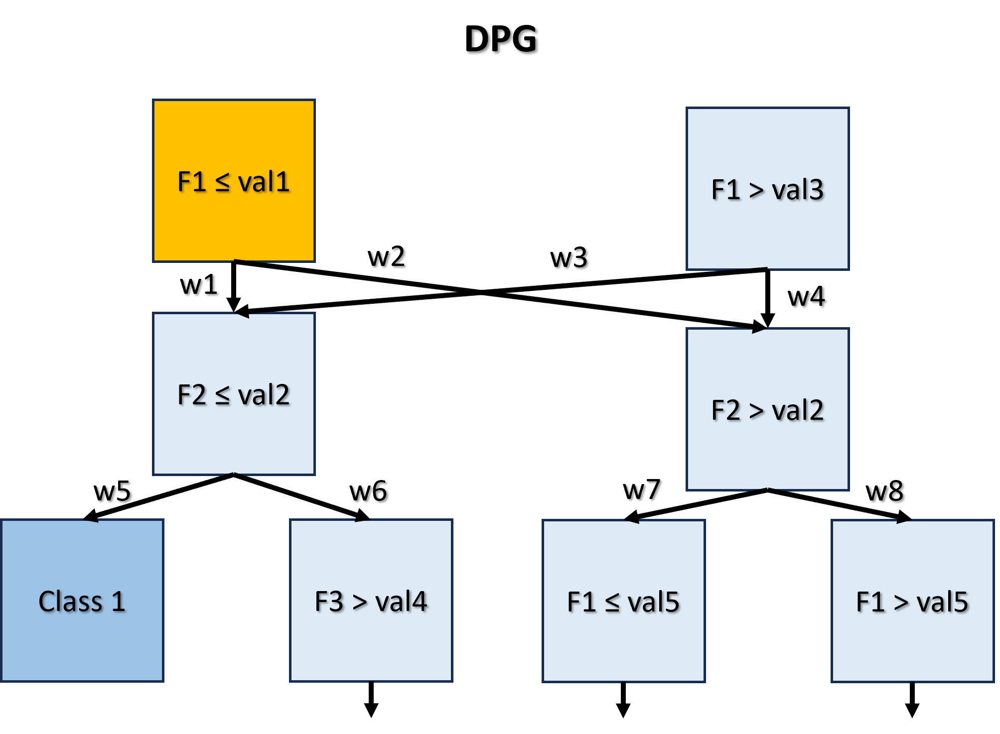
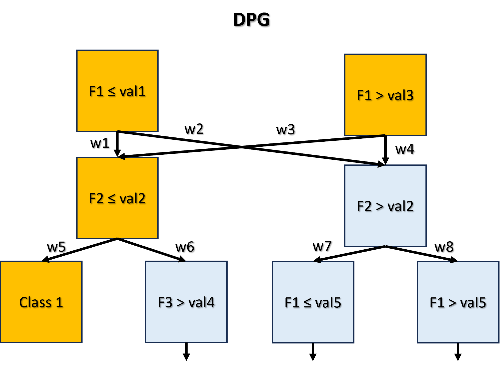

# Decision Predicate Graph (DPG)

[](LICENSE)
[](https://pypi.org/project/dpg/)
[](pyproject.toml)
[](https://github.com/Meta-Group/DPG/actions/workflows/tests.yml)
[](https://github.com/Meta-Group/DPG/actions/workflows/release.yml)
[](https://dpg.readthedocs.io/en/latest/)
[](https://machinelearning.inginf.units.it/DPG_web/#how)

<p align="center">
  
</p>

DPG is a model-agnostic framework for explaining tree ensembles. It converts
their decision logic into a graph, making predicates, transitions, predictions,
and structural diagnostics available in one representation.

## Highlights

- Global and local explanations through `DPGExplainer`
- Graph metrics, including constraints, betweenness centrality, local reaching
  centrality, and communities
- Local-path inspection, local-on-global plots, and faithfulness diagnostics
- Support for common scikit-learn tree ensembles

## Install

```bash
pip install dpg
```

DPG requires Python 3.10 or later. To render graphs, also install the Graphviz
system package so that `dot` is on your `PATH`.

For development and documentation builds, see [docs/README.md](docs/README.md).

## Quick start

```python
import numpy as np
from sklearn.datasets import load_iris
from sklearn.ensemble import RandomForestClassifier
from dpg import DPGExplainer

X, y = load_iris(return_X_y=True, as_frame=True)
model = RandomForestClassifier(n_estimators=5, random_state=42).fit(X, y)

explainer = DPGExplainer(
    model=model,
    feature_names=X.columns.tolist(),
    target_names=np.unique(y).astype(str).tolist(),
)
explanation = explainer.explain_global(X.values, communities=True)
explainer.plot("iris_dpg", explanation, save_dir="results")
```

## How DPG works

The concept behind DPG is to convert a generic tree-based ensemble model for classification into a graph, where:
- Nodes represent predicates, i.e., the feature-value associations present in each node of every tree;
- Edges denote the frequency with which these predicates are satisfied during the model training phase by the samples of the dataset.

<p align="center">
  
</p>

## Metrics

The graph-based nature of DPG provides significant enhancements in the direction of a complete mapping of the ensemble structure.

| Property     | Definition | Utility |
|--------------|------------|---------|
| _Constraints_  | The intervals of values for each feature obtained from all predicates connected by a path that culminates in a given class. | Calculate the classification boundary values of each feature associated with each class. |
| _Betweenness centrality_ | Quantifies the fraction of all the shortest paths between every pair of nodes of the graph passing through the considered node. | Identify potential bottleneck nodes that correspond to crucial decisions. |
| _Local reaching centrality_ | Quantifies the proportion of other nodes reachable from the local node through its outgoing edges. | Assess the importance of nodes similarly to feature importance, but enrich the information by encompassing the values associated with features across all decisions. |
| _Community_ | A subset of nodes of the DPG which is characterised by dense interconnections between its elements and sparse connections with the other nodes of the DPG that do not belong to the community. | Understanding the characteristics of nodes to be assigned to a particular community class, identifying predominant predicates, and those that play a marginal role in the classification process. |

|Constraints | Betweenness centrality | Local reaching centrality | Community|
|------------|------------|--------------|--------------------|
|  |  |  |  |
| Constraints(Class 1) = val3 < F1 ≤ val1, F2 ≤ val2 | BC(F2 ≤ val2) = 4/24 | LRC(F1 ≤ val1) = 6 / 7 | Community(Class 1) = F1 ≤ val1, F2 ≤ val2 |

## Local explanations and faithfulness

Fit the explainer once, then inspect an individual prediction or compare local
explanations with the fitted model:

```python
explainer.fit(X.values)
local = explainer.explain_local(X.iloc[0].values, sample_id=0)
details = explainer.evaluate_faithfulness(X.values, return_details=True)

print(local.majority_vote)
print(details["faithfulness_score"])
```

`evaluate_faithfulness` reports model agreement, trace coverage,
recombination, evidence margin, and a composite heuristic score. It is an
explanation-fidelity measure, not a probability of ground-truth correctness.

## Documentation and examples

- [Full documentation](https://dpg.readthedocs.io/en/latest/)
- [Quickstart](https://dpg.readthedocs.io/en/latest/quickstart.html)
- [Supported models](https://dpg.readthedocs.io/en/latest/supported_models.html)
- [Visualizations](https://dpg.readthedocs.io/en/latest/visualization.html)
- [Examples](examples), including [local explanations](examples/local_explanation_iris.py)
- [Parameter-sensitivity benchmark](tutorials/parameter_sensitivity_benchmark/README.md)
- [Interactive DPG sandbox](https://machinelearning.inginf.units.it/DPG_web/#how) — explore how DPG turns an ensemble into a graph in the browser.

<p align="center">
  <a href="https://machinelearning.inginf.units.it/DPG_web/#how">
    
  </a>
</p>

The packaged CLI mirrors `examples/run_dpg_standard.py`. Run `dpg --help` for
its current options and use `examples/run_dpg_custom.py` for a dataset with a
specified target column.

## Citation

If you use DPG in research, please cite:

```bibtex
@inproceedings{arrighi2024dpg,
  title={Decision Predicate Graphs: Enhancing Interpretability in Tree Ensembles},
  author={Arrighi, Leonardo and Pennella, Luca and Marques Tavares, Gabriel and Barbon Junior, Sylvio},
  booktitle={World Conference on Explainable Artificial Intelligence},
  pages={311--332},
  year={2024},
  isbn={978-3-031-63797-1},
  doi={10.1007/978-3-031-63797-1_16},
  publisher={Springer Nature Switzerland},
}
```
